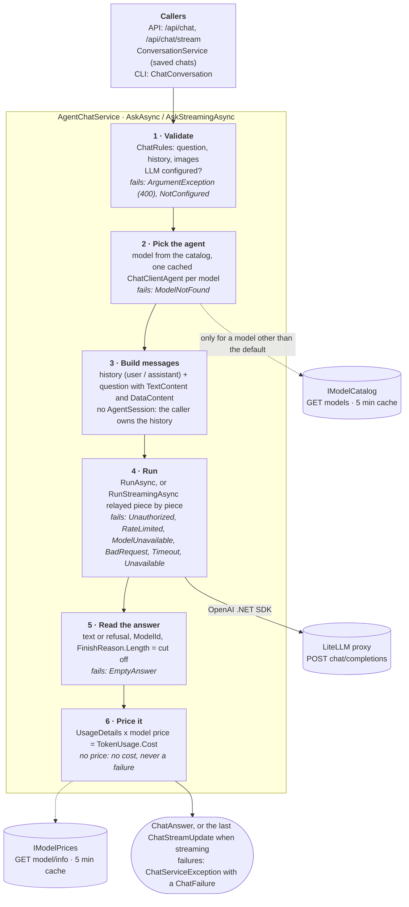

# DotNextAI

An LLM chatbot built step by step for the ERNI course *Project 1: Basic LLM Chatbot App*. It starts as a terminal script and becomes a local web app. The backend is .NET 10 with [Microsoft Agent Framework](https://learn.microsoft.com/agent-framework/), every model call goes through ERNI's LiteLLM proxy, and the web app (a later step) is Next.js with Fluent UI.

Technical documentation, backlog and decisions: [docs/](docs/README.md).

> **Status:** the whole course backlog (steps 01-10) is done, plus saved chats with folders in the web app. A web app (Next.js + Fluent UI, English/Spanish) and the terminal app chat through the same API and Microsoft Agent Framework agent over the LiteLLM proxy.

## Requirements

- .NET SDK 10 (LTS).
- Git Bash on Windows (it comes with Git for Windows), or WSL, macOS or Linux, to run `scripts/dev.sh`.
- A LiteLLM proxy URL and virtual key from ERNI, plus the name of a model it exposes.
- Node.js 24 LTS and npm (22 or later works locally), for the web app.
- Optional: Docker, to build the images locally (`docker build backend`, `docker build --build-arg NEXT_PUBLIC_API_BASE_URL=http://localhost:5100 frontend`). CI builds both.
- Playwright's Chromium for the E2E suite (`./scripts/dev.sh e2e` installs it).

## Running the project

From the repository root, in Git Bash:

```bash
./scripts/dev.sh secrets      # once: LiteLLM endpoint, default model and API key
./scripts/dev.sh              # API (http://localhost:5100) + web app (http://localhost:3030); Ctrl+C stops both
./scripts/dev.sh api --watch  # only the API, under dotnet watch (Swagger UI on /swagger)
./scripts/dev.sh web          # only the web app
./scripts/dev.sh cli ask "What is .NET?"   # terminal app: one question, one answer
./scripts/dev.sh cli          # terminal app: chat with history
./scripts/dev.sh test         # as in CI: .NET build + tests, then ESLint, type-check and Vitest (`test backend|frontend`)
./scripts/dev.sh build        # .NET Release build + Next.js production build (`build backend|frontend`)
./scripts/dev.sh e2e          # Playwright + axe: fake LiteLLM, real API, production web build (no secrets)
./scripts/dev.sh status       # SDK, LLM settings (never the key) and whether the API answers
./scripts/dev.sh --help
```

Without the script:

```powershell
dotnet run --project backend/src/DotNextAI.Api --launch-profile http
dotnet run --project backend/src/DotNextAI.Cli
dotnet test --solution backend/DotNextAI.slnx
npm --prefix frontend ci --ignore-scripts && npm --prefix frontend run dev   # needs frontend/.env.local, see .env.example
```

`node_modules` is OS-specific: dependencies installed from Windows do not work in WSL and vice versa. From WSL, `dev.sh` uses the Windows .NET SDK and Node.js when no Linux SDK is installed.

## Configuration

The settings live in the `Llm` section. The API and the CLI share one `dotnet user-secrets` store (`UserSecretsId` `b20f238b-…`), so `./scripts/dev.sh secrets` configures both. The script sends the values through stdin, so the key never appears in a command line.

| Setting | Meaning | Where |
| ------- | ------- | ----- |
| `Llm:Endpoint` | Base URL of the LiteLLM proxy. HTTPS (HTTP only on `localhost`) | user-secrets |
| `Llm:ApiKey` | Proxy virtual key (**secret**) | user-secrets |
| `Llm:DefaultModel` | Model name as exposed by the proxy | user-secrets |
| `Llm:TimeoutSeconds` | Timeout of each model call attempt, 5-600 (default 120) | `appsettings.json` |
| `Llm:ImageModel` | Image model for `/api/images` and `dotnextai image` (default `gpt-image-2`) | `appsettings.json` / user-secrets |
| `Llm:MaxRetries` | Retries on 408/429/5xx and network errors, 0-5 (default 2) | `appsettings.json` |
| `RateLimiting:ImagePermitsPerMinute` | Requests to `/api/images` per client IP and minute, 1-10,000 (default 5) | `appsettings.json` |
| `RateLimiting:ChatPermitsPerMinute` | Requests to `/api/chat` per client IP and minute, 1-10,000 (default 20) | `appsettings.json` |
| `Cors:AllowedOrigins` | Browser origins allowed to call the API (`http://localhost:3030` in Development) | `appsettings*.json` |
| `ConnectionStrings:Chats` | SQLite file of the saved chats (default `Data Source=App_Data/dotnextai.db`, relative to `backend/src/DotNextAI.Api`; `/app/data/dotnextai.db` in the Docker image) | `appsettings.json` |
| `Database:MigrateOnStartup` | Apply pending EF Core migrations when the API starts (default `true`) | `appsettings.json` |

Environment variables override both, using the `Llm__ApiKey` form. While the three `Llm` values are missing, the API still starts and `/api/health` reports `"llmConfigured": false`. The CLI exits with a hint.

To read or reset the store: `dotnet user-secrets list --project backend/src/DotNextAI.Api` (or `clear`). Windows and WSL keep separate stores.

### Saved chats database

The API saves the web app's conversations and folders in a local SQLite file, created and migrated on startup (`backend/src/DotNextAI.Api/App_Data/dotnextai.db`, git-ignored). Stop the API and delete the file to start from scratch. Schema changes are EF Core migrations ([saved chats](docs/specs/feature-saved-chats.md)):

```bash
dotnet tool restore                      # dotnet-ef, pinned in dotnet-tools.json
dotnet tool run dotnet-ef migrations add <Name> --project backend/src/DotNextAI.Persistence --output-dir Migrations
```

## Web app

Open `http://localhost:3030` after `./scripts/dev.sh`. A dashboard with the ValidatorHub layout and the ERNI brand:

- **Chat** (the start page, `/`): every conversation is saved (SQLite, through the API) and listed under **Saved chats**, where folders (one level) organise them; rename, move and delete from each chat's menu, and `/?c=<id>` reopens one after a reload. Enter sends, Shift+Enter adds a line, the answer appears as it is written (**Stop** keeps what arrived), **New conversation** starts over, and the **Model** selector picks one of the proxy's chat models (remembered). Attach up to 4 images (PNG, JPEG, WebP, GIF, 4 MB each) with the paperclip or by pasting; they go with that question only.
- **Images**: describe an image, pick a shape and generate it with the proxy's image model (`gpt-image-2`); download the results.
- **Tokens and cost**: every answer and image shows its tokens, and the chat shows the conversation's total (input grows with the history). Chat answers and the conversation also show their cost in US dollars, at the prices configured in the LiteLLM proxy (`model/info`).
- **Header**: language selector (English / Español, remembered in a cookie) and appearance (system / light / dark).

Details in the [web app spec](docs/specs/feature-web-app.md).

## Terminal app

`dotnextai` is a permanent part of the project: it keeps working, and grows with the backlog, next to the web app. Full behavior in the [CLI spec](docs/specs/feature-cli.md).

```bash
dotnextai                            # chat with history (/new, /help, /exit; Ctrl+D to quit)
dotnextai chat < questions.txt       # one question per line, answers only on stdout
dotnextai ask "What is .NET?"        # one question, no history (quotes optional)
dotnextai ask -i cat.png "What is in this picture?"   # with images (up to 4; /image <path> in the chat)
dotnextai image A fox reading -s landscape -o fox.png   # generate an image (prints the file's path)
dotnextai models                     # chat models of the proxy; use one with ask -m <name> or /model <name>
echo "Summarize: ..." | dotnextai ask  # one multi-line question from stdin
dotnextai --help
```

Answers go to stdout and everything else to stderr, so answers can be piped. After each answer stderr shows `Tokens: … in · … out · … total` when the proxy reports them; `/usage` in the chat gives the conversation's total. Exit codes: `0` answer or chat ended, `1` model error, `2` usage error, `3` not configured, `130` Ctrl+C. Run it with `./scripts/dev.sh cli …` or `dotnet run --project backend/src/DotNextAI.Cli -- …`.

## API

```bash
curl -s -H "Content-Type: application/json" \
  -d '{"question":"What is my name?","history":[{"role":"user","text":"My name is Ana."},{"role":"assistant","text":"Hi Ana!"}]}' \
  http://localhost:5100/api/chat
# {"answer":"Your name is Ana.","model":"gpt-6-luna","truncated":false}
```

`/api/chat` is stateless: the client sends the history with every question. Saved chats (`/api/folders`, `/api/conversations`) keep it in the database instead, and `POST /api/conversations/{id}/messages/stream` takes only the new question. `GET /api/models` lists the chat models, `model` in the body picks one, and `POST /api/chat/stream` takes the same body and streams the answer as Server-Sent Events (`delta`, `done`, `error`). Errors are `ProblemDetails` with a `failure` code (`ModelUnavailable`, `Timeout`, …). See the [API contract](docs/design/api.md), or use `backend/src/DotNextAI.Api/DotNextAI.Api.http` and Swagger UI.

## Project layout

```text
global.json  SDK line and Microsoft.Testing.Platform (applies to the whole repository)
dotnet-tools.json  local .NET tools (dotnet-ef)
backend/
  DotNextAI.slnx  Directory.Build.props
  src/DotNextAI.Api             Minimal API (port 5100): health, chat, models, images, saved chats
  src/DotNextAI.Application     DTOs, interfaces, chat and conversation rules
  src/DotNextAI.Infrastructure  LLM options and clients (Agent Framework)
  src/DotNextAI.Persistence     saved chats: EF Core + SQLite, migrations
  src/DotNextAI.Cli             terminal app (dotnextai)
  tests/DotNextAI.UnitTests  tests/DotNextAI.IntegrationTests
frontend/   Next.js + Fluent UI web app (port 3030): src/app, components, lib (i18n, theme, chat), services
docs/       specs, design, tasks
scripts/    dev.sh
```

See [architecture](docs/design/architecture.md) for the components and the decisions behind them.

## How a question flows

Every question, from the web app, the API or the terminal, goes through `AgentChatService` (`backend/src/DotNextAI.Infrastructure/Chat/AgentChatService.cs`), the Microsoft Agent Framework implementation of `IChatService`:



1. **Validate.** `ChatRules` checks the question, the history and the images (format from the bytes, count, size) before anything is spent; a broken rule is an `ArgumentException`, which the API answers as 400. A missing LLM configuration is `NotConfigured`.
2. **Pick the agent.** The model is the one asked for or `Llm:DefaultModel`. Any other model must be a chat model of the proxy (`IModelCatalog`), or the call fails with `ModelNotFound`, so a client's model name never reaches the proxy unchecked. Each model gets one `ChatClientAgent` (`LlmChatClientFactory.Create(...).AsAIAgent(instructions, name)`), created on first use and reused.
3. **Build the messages.** The caller passes the history with every question: the service keeps no conversation and uses no `AgentSession` (the CLI keeps it in memory, saved chats in SQLite). The question goes last, with its images as `DataContent`; the history stays text.
4. **Run.** `RunAsync` returns the whole answer; `RunStreamingAsync` yields an update per piece, relayed at once as `ChatStreamUpdate(text)`. The agent puts its instructions first and calls the proxy through the OpenAI SDK (timeout, retries, the `Llm` `HttpClient`). `ChatFailureMapper` turns failures into a `ChatFailure`: the proxy's HTTP status (`Unauthorized`, `RateLimited`, `ModelUnavailable`, `BadRequest`…), a timeout (`Timeout`), or a lost connection (`Unavailable`, also when a stream breaks after some text).
5. **Read the answer.** The text, or the model's refusal when there is none; still empty is `EmptyAnswer`. `ModelId` says which model answered and `FinishReason.Length` marks a cut-off answer. Only metadata is logged, never prompts or answers.
6. **Price it.** The provider's `UsageDetails` (from the final `UsageContent` when streaming) become a `TokenUsage`, priced with the proxy's prices of the model asked for (`IModelPrices`, cached input included). No price means no cost, never a failure. The result is a `ChatAnswer`; when streaming it travels in the last `ChatStreamUpdate`.

The API turns a `ChatFailure` into ProblemDetails with a `failure` code (`ChatProblems`), or into an `error` event once a stream has started, and the web app and the CLI translate that code ([chat service spec](docs/specs/feature-llm-chat.md), [API contract](docs/design/api.md)).

## Security notes

- The LiteLLM key stays in the backend: it is not in API responses, error messages, logs or tracked files. Tests check `/api/health` and the error messages (the key is masked even if the proxy echoes it).
- Prompts and answers are never logged; logs hold model, duration and status only.
- Saved chats (text and images) sit unencrypted in the local SQLite file and have no owner: anyone who can reach the API can read them. Keep the API on localhost.
- The web app sends a strict, nonce-based Content-Security-Policy; the browser may only connect to the app and the API.
- The build runs the .NET security analyzers and fails on vulnerable NuGet packages (`NuGetAudit`). Restores are reproducible from `packages.lock.json`.
- The API accepts browser calls only from the origins in `Cors:AllowedOrigins`.
- The API has no authentication and is meant for local use; `/api/chat` is rate-limited per IP because every call spends the LiteLLM key. Add authentication before exposing it anywhere else.
- Tests never call the real proxy and need no secrets.

## CI

GitHub Actions, the same pipelines as ValidatorHub and ctf-janus:

| Workflow | Runs on | What it does |
| -------- | ------- | ------------ |
| `backend-ci.yml` | Changes to `backend/`, `global.json`, `nuget.config`, `dotnet-tools.json` | Semgrep (C#, Dockerfile, secrets) → locked restore → vulnerable-package check → Release build with `-warnaserror` → EF Core migrations up to date → unit and integration tests with coverage → API image build, CycloneDX SBOM and Trivy scan (fails on fixable HIGH/CRITICAL) |
| `frontend-ci.yml` | Changes to `frontend/` | Semgrep (TypeScript, React, Next.js, Dockerfile, secrets) → `npm ci --ignore-scripts` → registry signatures and `npm audit` → ESLint → type-check → Vitest with coverage → production build → web image build, SBOM and Trivy scan |
| `e2e.yml` | Changes to `frontend/` or `backend/` | Builds the API, then Playwright starts a fake LiteLLM proxy, the API and the production web build, and runs the browser suite with axe accessibility checks ([testing](docs/design/testing.md)) |
| `security.yml` | Every push and PR to `main`, plus weekly | Gitleaks over the whole git history, and zizmor over the workflows |
| `dependabot.yml` | Weekly | npm, NuGet, Docker base images and GitHub Actions, each update 7 days after its release. Framework majors (.NET 11, Node, TypeScript, ESLint) are done manually |

All actions are pinned by commit SHA, tool binaries by version and checksum, and the workflows use `permissions: contents: read` and need no secrets.

## Verification

```bash
./scripts/dev.sh test
./scripts/dev.sh e2e
```

Expected: .NET build with 0 warnings, ESLint and type-check clean, all tests green (frontend: Vitest suites; backend: `LlmOptionsTests`, `ChatRulesTests`, `ChatConversationTests`, `AgentChatServiceTests`, `CliApplicationTests`, `ChatCommandTests`, `HealthEndpointTests`, `ChatEndpointTests`, `SqliteConversationStoreTests`, `ConversationServiceTests`, `ConversationEndpointTests`). E2E: 31 Playwright scenarios with no axe violation. Against the real proxy: `./scripts/dev.sh cli ask "Reply with exactly: pong"`.
