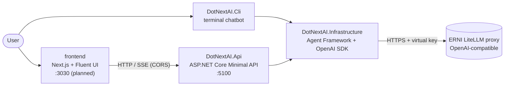

# Architecture

> **Status:** Step 01 implemented on 2026-11-16 (terminal Q&A through the LiteLLM proxy), on top of step 00 (backend skeleton, health endpoint, backend CI). Components marked *planned* arrive with later backlog steps.

## Components

| Component | Responsibility |
| --------- | -------------- |
| `DotNextAI.Api` | HTTP surface. Today: `GET /api/health`. Planned: chat, streaming (SSE), models, image generation. OpenAPI document at `/openapi/v1.json` and Swagger UI at `/swagger` in Development. |
| `DotNextAI.Application` | Contracts with no dependencies: DTOs (`HealthStatusDto`), the chat contract (`IChatService`, `ChatAnswer`, `ChatFailure`, `ChatServiceException`, `ChatRules`) and, later, images. |
| `DotNextAI.Infrastructure` | Configuration (`LlmOptions`) and the model clients. Step 01: `OpenAiChatService`, the OpenAI .NET SDK `ChatClient` pointed at the proxy over the named `HttpClient` `Llm`. From step 02: Agent Framework agents over `IChatClient` ([chat service spec](../specs/feature-llm-chat.md)). |
| `DotNextAI.Cli` | Terminal app `dotnextai`, a permanent deliverable: System.CommandLine commands (`ask` today) over `IChatService`. It uses the same Infrastructure as the API, so the logic is written once ([CLI spec](../specs/feature-cli.md)). |
| `frontend` | *Planned (step 05).* Multi-language chat UI that only talks to `DotNextAI.Api`. |

Project references: `Api → Application, Infrastructure`; `Cli → Application, Infrastructure`; `Infrastructure → Application`. Application references nothing.

## Ports

| Service | URL |
| ------- | --- |
| API | `http://localhost:5100` (`launchSettings.json`, profile `http`) |
| Web app (planned) | `http://localhost:3030`, already allowed by CORS in Development |

## API

| Method | Path | Answer |
| ------ | ---- | ------ |
| `GET` | `/api/health` | `200` `{ status, service, environment, llmConfigured, timestampUtc }`. `llmConfigured` is true when endpoint, key and default model are set. It never contains the endpoint or the key. |

Errors use `ProblemDetails` (`AddProblemDetails`, `UseExceptionHandler`, `UseStatusCodePages`).

## Configuration

`LlmOptions` (section `Llm`) is bound with `ValidateDataAnnotations` and `ValidateOnStart`. Missing values do not stop the startup, so the API runs and `llmConfigured` is false. An out-of-range `TimeoutSeconds` or `MaxRetries` does stop it. The secrets live in `dotnet user-secrets`, in one store shared by the API and the CLI (same `UserSecretsId`). The CLI runs in `Development` by default so it loads that store. The integration tests use the `Testing` environment so they never load it. See the [README](../../README.md#configuration) for the setting list.

## Build and quality

- `backend/Directory.Build.props`: `net10.0`, nullable, .NET analyzers `latest-recommended` with the security rules set to `All`, `NuGetAudit` (vulnerable packages fail the build), and `packages.lock.json` with locked-mode restore when `ContinuousIntegrationBuild=true`.
- `global.json` (repository root, so it applies from the root and from `backend/`): SDK 10.0.100 or a later feature band; tests run on Microsoft.Testing.Platform (xUnit v3).
- `backend/tests/Directory.Build.props`: test projects are executables; `CA1707` allowed for `Method_Scenario_Expected` names.
- `backend/Dockerfile`: multi-stage image of the API (SDK and ASP.NET base images pinned by digest, locked restore, non-root `$APP_UID`, port 8080, `Production`). The LLM settings come from environment variables at run time. The CLI has no image.
- CI, mirroring ValidatorHub and ctf-janus (see the [README](../../README.md#ci)): `backend-ci.yml` and `security.yml` are implemented, with Dependabot on a 7-day cooldown. `frontend-ci.yml` and `e2e.yml` (Playwright) are planned.

## Decisions log

| Date | Topic | Decision | Reason |
| ---- | ----- | -------- | ------ |
| 2026-11-16 | Runtime | .NET 10 (LTS), ASP.NET Core and `Microsoft.Extensions.*` packages on the 10.0.x line. | The installed SDK is 10.0.301. ValidatorHub and ctf-janus use the same line. .NET 11 packages exist but are not LTS. |
| 2026-11-16 | Orchestration | Microsoft Agent Framework (`Microsoft.Agents.AI`, 1.x stable) on Microsoft.Extensions.AI, instead of LangChain or Semantic Kernel. | It is Microsoft's successor to Semantic Kernel and AutoGen. `IChatClient` gives streaming, multimodal content (`DataContent`) and usage (`UsageDetails`) out of the box. |
| 2026-11-16 | Direct calls (step 01) | OpenAI .NET SDK with its endpoint set to the LiteLLM proxy. | LiteLLM is a Python library; from .NET, its OpenAI-compatible proxy is the way to use it. |
| 2026-11-16 | API style | Minimal API with `TypedResults`, not controllers as in ValidatorHub and ctf-janus. | Small surface, and native SSE (`TypedResults.ServerSentEvents`) for streaming. |
| 2026-11-16 | Layering | ValidatorHub's `backend/src` + `backend/tests` layout without a `Domain` project. | There are no persisted entities. A `Domain` layer can be added if one appears. |
| 2026-11-16 | Secrets | `dotnet user-secrets`, one store shared by the API and the CLI, written by `dev.sh secrets` through stdin. | Same practice as the reference repos. One setup serves both executables, and the key never shows up in a process list. |
| 2026-11-16 | Tests | xUnit v3 on Microsoft.Testing.Platform, `WebApplicationFactory` in the `Testing` environment, and fake model clients. | Same as ValidatorHub. Tests and CI need no proxy and no secrets. |
| 2026-11-16 | Web app | Next.js + React + Fluent UI v9, port 3030 (planned). | Same stack as the ValidatorHub frontend and the ctf-janus admin. The port avoids clashing with them (3000, 3010). |
| 2026-11-16 | CI | `backend-ci.yml` = ValidatorHub's build job (MTP `--solution` tests) + ctf-janus's Docker job (Trivy binary verified by checksum, not `trivy-action`). `security.yml` copied unchanged (identical in both repos). | Same guarantees as the reference repos. ctf-janus moved away from `trivy-action` after it was compromised in 2026. |
| 2026-11-16 | Dependabot | Ignore semver-major updates of `Microsoft.AspNetCore.*`, `Microsoft.Extensions.*` and the `dotnet/*` base images. | Keeps the backend on the .NET 10 LTS line. A move to 11.x is a manual change of the target framework, packages and images together. |
| 2026-11-16 | Model call (step 01) | `IChatService` in Application, implemented by `OpenAiChatService` (OpenAI SDK `ChatClient`) in Infrastructure. The SDK's transport is an `IHttpClientFactory` client. | The CLI and the API share one implementation, step 02 can swap it for Agent Framework without touching the front ends, and tests stub HTTP instead of calling the proxy. |
| 2026-11-16 | Proxy errors | Quote the first line of LiteLLM's `error.message` for 400/404/422 (key masked, max 300 characters). "No healthy deployments" maps to its own `ModelUnavailable` failure. | A status-only message ("rejected the request as invalid") hid the real cause when the proxy's models were down on the first run. |
| 2026-11-16 | CLI | System.CommandLine 2.0.15 (.NET 10 servicing line), invariant culture, UTF-8, logs off by default, stdout for answers only. | A permanent, scriptable terminal app with consistent English texts. 3.0.0 is the .NET 11 line. |
| 2026-11-16 | Package age | Microsoft .NET servicing packages (10.0.x, System.CommandLine 2.0.x) are taken at the latest patch. Third-party packages must be at least 7 days old (OpenAI 2.15.0: 2026-11-05). | Servicing releases carry security fixes; the 7-day cooldown targets compromised third-party releases. |
