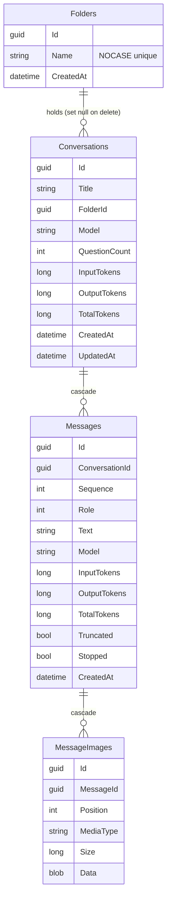

# Saved chats

> **Status:** Implemented on 2026-11-16: part 1 (backend: database, API, tests) and part 2 (web). On 2026-11-17 the *Saved chats* moved from a panel of the chat page into the side navigation, under *Workspace*. The CLI keeps its conversations in memory.

The web app's conversations are saved in a local SQLite database, so they survive a reload and can be organised in folders. This is the first feature after the ten course steps; it reverses the product rule "no persistence for now" ([product rules](product-rules.md#global-rules)).

## Decisions

| Topic | Decision | Date |
| ----- | -------- | ---- |
| Storage | One SQLite file through EF Core 10 (`Microsoft.EntityFrameworkCore.Sqlite`) in a new `DotNextAI.Persistence` project. Default `backend/src/DotNextAI.Api/App_Data/dotnextai.db` (connection string `Chats`, relative paths resolved against the API's content root), git-ignored. | 2026-11-16 |
| Why SQLite | A local, single-user app: one file, no server to run, and EF Core migrations keep the schema in the code. A server database can replace it behind `IConversationStore` if the app is ever deployed. | 2026-11-16 |
| Users | A single local user, no login. Every conversation and folder belongs to whoever runs the API. Authentication (and an owner per row) comes before exposing the API beyond localhost ([todo](../tasks/todo.md)). | 2026-11-16 |
| Folders | One level: a conversation is in one folder or in none. Folder names are unique ignoring case. Deleting a folder keeps its conversations, without a folder. | 2026-11-16 |
| What is saved | Everything: questions, answers, the images sent with a question (bytes in the database, served by the API), the model, the usage of every answer, and whether it was cut off or stopped. | 2026-11-16 |
| History owner | For a saved conversation the **server** builds the history from the database; the client sends only the new question (`POST /api/conversations/{id}/messages/stream`). The stateless `/api/chat` endpoints stay for the CLI-style use and for unsaved chats. | 2026-11-16 |
| When an exchange is saved | Question and answer together, once the answer is complete. A **stopped** answer (the client closed the stream) is saved with the text so far, marked `stopped`, without usage. A **failed** answer saves nothing: the question goes back to the composer, as before. | 2026-11-16 |
| Title | A new conversation is called *New conversation*. Its first question names it (first line, spaces collapsed, cut at a word near 60 characters with "…"), unless it was renamed before. The user can rename it (1-200 characters). | 2026-11-16 |
| CLI | Unchanged: the terminal chat keeps its history in memory (`ChatConversation`). | 2026-11-16 |
| Schema changes | EF Core migrations in `DotNextAI.Persistence/Migrations`, applied at API startup (`Database:MigrateOnStartup`, default true). CI fails when the model has changes without a migration (`dotnet-ef migrations has-pending-model-changes`). `dotnet-ef` is a local tool in the root `dotnet-tools.json`. | 2026-11-16 |
| Logs | Saved content is never logged, like prompts and answers. | 2026-11-16 |
| Web: where | A *Saved chats* section of the app's side navigation, under *Workspace*, on every page. It replaced (2026-11-17) a panel of its own on the chat page, because two sidebars side by side looked like two navigations. Long titles end with "…" (full title on hover). The collapsed icon rail leaves the section out; the overlay drawer on small screens shows it and closes when a chat is chosen. The list lives in `SavedChatsProvider` (app shell), shared by the navigation and the chat page. | 2026-11-17 |
| Web: every chat is saved | The web chat always uses the saved chats endpoints; there is no unsaved mode. A chat is created by its first question (`POST /api/conversations`), so opening the page or pressing *New conversation* creates nothing. | 2026-11-16 |
| Web: no empty chats | If the first question of a new chat saves nothing (it fails, or is stopped before any text, or the page is left before any text), the chat is deleted again, so the list never fills with empty *New conversation* entries. | 2026-11-16 |
| Web: address | The open chat is in the address (`/chat?c=<id>`, set with `history.replaceState`, no navigation), so a reload or a link reopens it; each chat in the navigation is a real link, so it also opens in a new tab. On the chat page a chat opens in place; from any other page the link navigates to the chat page. `/chat` is a new conversation. A chat that no longer exists opens a new conversation with a notice. | 2026-11-16 |
| Web: actions | Rename, move and delete from a menu per chat (*Options for …*), rename and delete per folder, *New folder* (folder icon button) next to the section's title. Names and moves in modal dialogs (moving uses a native select with *No folder* and the folders), deletes in alert dialogs. Dialogs stay mounted while they close: unmounting an open Fluent dialog left the page `aria-hidden`. | 2026-11-16 |
| Web: untitled | The server's *New conversation* title is shown in the selected language. A stopped first answer titles the chat in the list at once (the same rule as the server, `titleFrom`), because a stopped stream has no `done` event. | 2026-11-16 |
| Web: images | Saved images load from the API (`` of `GET …/images/{imageId}`), so the CSP's `img-src` allows the API origin. Their names are not stored: they are announced as *Attached image 1*, *2*… | 2026-11-16 |

## Rules

| Rule | Value | Where |
| ---- | ----- | ----- |
| Folder name | Trimmed, 1-100 characters, no control characters, unique ignoring case | `ConversationRules.TryNormalizeFolderName`, unique `NOCASE` index |
| Conversation title | Trimmed, 1-200 characters, no control characters | `ConversationRules.TryNormalizeTitle` |
| Automatic title | First line of the first question, at most about 60 characters | `ConversationRules.TitleFrom` |
| Questions per conversation | 50, like an unsaved chat (`ChatRules.MaxConversationQuestions`); the 51st is 409 `ConversationFull` | `ConversationService` |
| Question and images | Same rules as the chat (`ChatRules`) | `ConversationEndpoints` |
| Order | Folders by name; conversations by last update, newest first; messages in the order they were written | `SqliteConversationStore` |

## Data model

The conversation keeps its totals (questions, tokens, last model), so the list never reads the messages. Lists and the conversation detail never load image bytes; only `GET …/images/{imageId}` does.

## Web app

The side navigation (`SideNav`, the *Main navigation* landmark) has, under the *Workspace* links, the *Saved chats* section (`SavedChatsSection`, a `region` named by its `h3` section header). The chat page (`/chat`, `ChatWorkspace`) shows the open chat (`ChatView`) and tells the section which one it is:

- **Header:** *Saved chats* and the **New folder** icon button.
- **Folders:** one `region` per folder (`h4` with its name and *Options for the folder …*: *Rename…*, *Delete…*), with its chats, or *No chats in this folder.*
- **Chats:** a link per chat with its title (the open one with `aria-current="page"`) and *Options for …*: *Rename…*, *Move to folder…*, *Delete…*. Chats without a folder come last, under *Without a folder* when there are folders.
- **Empty and failure states:** *No saved chats yet. A chat is saved when you ask its first question.*; *Loading saved chats…*; *The saved chats could not be loaded.* with **Try again**.
- **Dialogs:** *New folder* / *Rename folder* (*Folder name*), *Rename chat* (*Title*), *Move chat* (*Folder for “…”*: *No folder* or a folder), *Delete this chat?* (*“…” and its messages and images will be deleted. This cannot be undone.*), *Delete this folder?* (*… Its chats are kept, without a folder.*). Names are checked in the browser first (*Type a name first.*, too long, no tabs or line breaks); a taken name shows *A folder with that name already exists.* under the field.
- **Opening a chat:** *Opening the chat…*, then its messages with models, tokens, *cut off* and *Stopped before the end.* marks and images. The next question goes on in it.

Texts in English and Spanish (`saved.*`, `error.NotFound`, `error.DuplicateFolderName`, …).

## API

Folders (`/api/folders`) and conversations (`/api/conversations`): list, create, rename, move, delete, read one with its messages, read an image, and ask with streaming. Contract, bodies and status codes: [API contract](../design/api.md#saved-chats).

## Verification

- `SqliteConversationStoreTests` (unit, in-memory SQLite with the real migrations): folders listed by name and renamed; names unique ignoring case, renaming to the same name in other case allowed; a deleted folder keeps its conversations without a folder; conversations newest first; an exchange saves both messages in order with totals and title; images stored and served one by one, not across conversations; deleting a conversation deletes its messages and images; moving to a missing folder; missing conversation.
- `ConversationServiceTests` (unit): the exchange saved and the conversation named after the first question; the saved history sent with the next question and the title kept; images saved with the question; a stopped answer saved with the text so far, `stopped` and no usage; a failed answer saves nothing; a full conversation and a missing one refused before calling the model; the title and name rules.
- `ConversationEndpointTests` (integration, a temporary SQLite file per client): folder create, list, rename, delete, 404, 409 on a duplicate, 400 on an empty name; conversation defaults, rename, move into and out of a folder, delete; 400 for an unknown folder on create and move; ask streams, saves and sends the saved history; images saved and served with their type and `nosniff`; 404 for an unknown conversation and 400 for an invalid question or unknown model before the model is called; a failure before the stream keeps its status and saves nothing; a failure mid-stream sends `error` and saves nothing; CORS preflight for `PATCH`, `PUT`, `DELETE`.
- CI: `dotnet-ef migrations has-pending-model-changes` in `backend-ci.yml`.
- `ChatWorkspace.test.tsx` (Vitest, the provider, the real `SideNav` and the chat page, fetch stubbed with an in-memory saved chats backend, `savedChatsBackend`): the section under the *Workspace* links of the main navigation; a chat opened from another page navigates to `/chat?c=<id>`; the list by folder with the untitled chat in Spanish; the empty list; a new chat saved by its first question, current and in the address; no empty chat left when the first question fails; a saved chat opened with its messages, stopped mark and API image, going on in it; a missing chat from the address; a folder created and a duplicate refused under the field; the name checked before calling the API; move and rename; deleting the open chat; deleting a folder keeps its chats; retry after a list failure.
- `ChatView*.test.tsx`: the questions go to `…/conversations/{id}/messages/stream` without history; a new conversation is a new saved chat.
- `savedChats.test.ts`: `titleFrom` and the name rules as on the server, list order, grouping, saved messages mapped for display. `contentSecurityPolicy.test.ts`: `img-src` with the API origin.
- `e2e/saved-chats.spec.ts` (Playwright, real API and database): a chat kept after a reload that answers from its saved history; opening chats from the navigation, also from the *Images* page; folders created, moved into, renamed, kept after a reload and deleted, with axe on the dialog and the navigation; a taken folder name; a stopped answer kept as stopped; an image saved and loaded from the API through the CSP; a missing chat in the address.
