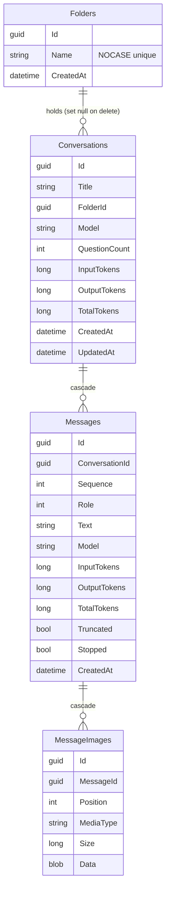

# Saved chats

> **Status:** Part 1 (backend: database, API, tests) implemented on 2026-11-16. Part 2 (web sidebar) is next. The CLI keeps its conversations in memory.

The web app's conversations are saved in a local SQLite database, so they survive a reload and can be organised in folders. This is the first feature after the ten course steps; it reverses the product rule "no persistence for now" ([product rules](product-rules.md#global-rules)).

## Decisions

| Topic | Decision | Date |
| ----- | -------- | ---- |
| Storage | One SQLite file through EF Core 10 (`Microsoft.EntityFrameworkCore.Sqlite`) in a new `DotNextAI.Persistence` project. Default `backend/src/DotNextAI.Api/App_Data/dotnextai.db` (connection string `Chats`, relative paths resolved against the API's content root), git-ignored. | 2026-11-16 |
| Why SQLite | A local, single-user app: one file, no server to run, and EF Core migrations keep the schema in the code. A server database can replace it behind `IConversationStore` if the app is ever deployed. | 2026-11-16 |
| Users | A single local user, no login. Every conversation and folder belongs to whoever runs the API. Authentication (and an owner per row) comes before exposing the API beyond localhost ([todo](../tasks/todo.md)). | 2026-11-16 |
| Folders | One level: a conversation is in one folder or in none. Folder names are unique ignoring case. Deleting a folder keeps its conversations, without a folder. | 2026-11-16 |
| What is saved | Everything: questions, answers, the images sent with a question (bytes in the database, served by the API), the model, the usage of every answer, and whether it was cut off or stopped. | 2026-11-16 |
| History owner | For a saved conversation the **server** builds the history from the database; the client sends only the new question (`POST /api/conversations/{id}/messages/stream`). The stateless `/api/chat` endpoints stay for the CLI-style use and for unsaved chats. | 2026-11-16 |
| When an exchange is saved | Question and answer together, once the answer is complete. A **stopped** answer (the client closed the stream) is saved with the text so far, marked `stopped`, without usage. A **failed** answer saves nothing: the question goes back to the composer, as before. | 2026-11-16 |
| Title | A new conversation is called *New conversation*. Its first question names it (first line, spaces collapsed, cut at a word near 60 characters with "…"), unless it was renamed before. The user can rename it (1-200 characters). | 2026-11-16 |
| CLI | Unchanged: the terminal chat keeps its history in memory (`ChatConversation`). | 2026-11-16 |
| Schema changes | EF Core migrations in `DotNextAI.Persistence/Migrations`, applied at API startup (`Database:MigrateOnStartup`, default true). CI fails when the model has changes without a migration (`dotnet-ef migrations has-pending-model-changes`). `dotnet-ef` is a local tool in the root `dotnet-tools.json`. | 2026-11-16 |
| Logs | Saved content is never logged, like prompts and answers. | 2026-11-16 |

## Rules

| Rule | Value | Where |
| ---- | ----- | ----- |
| Folder name | Trimmed, 1-100 characters, no control characters, unique ignoring case | `ConversationRules.TryNormalizeFolderName`, unique `NOCASE` index |
| Conversation title | Trimmed, 1-200 characters, no control characters | `ConversationRules.TryNormalizeTitle` |
| Automatic title | First line of the first question, at most about 60 characters | `ConversationRules.TitleFrom` |
| Questions per conversation | 50, like an unsaved chat (`ChatRules.MaxConversationQuestions`); the 51st is 409 `ConversationFull` | `ConversationService` |
| Question and images | Same rules as the chat (`ChatRules`) | `ConversationEndpoints` |
| Order | Folders by name; conversations by last update, newest first; messages in the order they were written | `SqliteConversationStore` |

## Data model

The conversation keeps its totals (questions, tokens, last model), so the list never reads the messages. Lists and the conversation detail never load image bytes; only `GET …/images/{imageId}` does.

## API

Folders (`/api/folders`) and conversations (`/api/conversations`): list, create, rename, move, delete, read one with its messages, read an image, and ask with streaming. Contract, bodies and status codes: [API contract](../design/api.md#saved-chats).

## Verification

- `SqliteConversationStoreTests` (unit, in-memory SQLite with the real migrations): folders listed by name and renamed; names unique ignoring case, renaming to the same name in other case allowed; a deleted folder keeps its conversations without a folder; conversations newest first; an exchange saves both messages in order with totals and title; images stored and served one by one, not across conversations; deleting a conversation deletes its messages and images; moving to a missing folder; missing conversation.
- `ConversationServiceTests` (unit): the exchange saved and the conversation named after the first question; the saved history sent with the next question and the title kept; images saved with the question; a stopped answer saved with the text so far, `stopped` and no usage; a failed answer saves nothing; a full conversation and a missing one refused before calling the model; the title and name rules.
- `ConversationEndpointTests` (integration, a temporary SQLite file per client): folder create, list, rename, delete, 404, 409 on a duplicate, 400 on an empty name; conversation defaults, rename, move into and out of a folder, delete; 400 for an unknown folder on create and move; ask streams, saves and sends the saved history; images saved and served with their type and `nosniff`; 404 for an unknown conversation and 400 for an invalid question or unknown model before the model is called; a failure before the stream keeps its status and saves nothing; a failure mid-stream sends `error` and saves nothing; CORS preflight for `PATCH`, `PUT`, `DELETE`.
- CI: `dotnet-ef migrations has-pending-model-changes` in `backend-ci.yml`.
